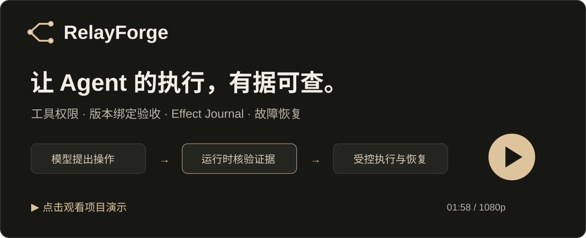
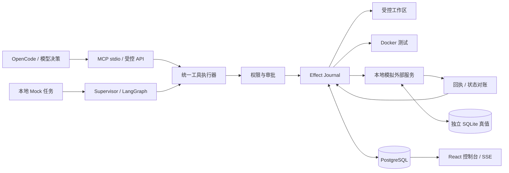

# RelayForge

**面向 Coding Agent 的可靠执行 Runtime / Harness。**

当外部操作已经成功，而执行进程在保存回执前崩溃时，直接重试可能产生重复操作，直接报成功又缺乏依据。RelayForge 在工具执行边界记录动作身份与结果凭证，通过外部状态对账恢复执行；证据不足时保留 `UNKNOWN`，暂停等待处理。

它同时管理工具权限、受控代码修改、Docker 测试和版本绑定验收，让“任务已完成”对应可检查的执行证据。

[](docs/media/relayforge-demo.mp4)

**[▶ 观看项目介绍 · 1 分 58 秒 · 1080p](docs/media/relayforge-demo.mp4)**

## 核心能力

| 能力 | 实际行为 |
| --- | --- |
| Effect Journal | 为逻辑动作保留稳定身份，绑定参数哈希，记录派发、结果和恢复决策；同一身份使用不同参数时拒绝执行。 |
| 故障恢复 | 处理提交成功但回执丢失、执行进程退出等情况；通过可信查询确认原操作，无法核验时暂停。 |
| 测试与验收门禁 | 保存受测源码、测试配置与结果凭证；代码在测试后变化、测试失败、存在相关未知操作或缺少审批时，拒绝最终模拟提交。 |
| 权限与分支 | 工具采用 allow / ask / deny 策略；Fork 恢复独立工作区、只读引用历史结果，新操作重新检查审批。 |
| Agent 工具接入 | 提供九个 MCP 工具，外部 Coding Agent 可依据真实测试反馈选择修改与重测；执行与最终验收仍由 Runtime 控制。 |
| 开发者控制台 | 查看运行流程、事件时间线、代码 Diff、测试输出、操作账本、审批、恢复依据与对照评测。 |

## 如何工作



正常任务依次完成读取、修改、测试、审查和验收。测试实际运行在 Docker 中，验收同时检查**当前代码与通过测试的代码是否为同一版本**，不使用 Git commit hash 代替工作区内容指纹。

外部写操作的典型恢复流程：

1. 保存动作意图，经过权限检查后派发工具。
2. 外部提交完成，进程在回执持久化前退出，本地留下 `IN_FLIGHT`。
3. 新执行者确认旧执行者停止，将不确定结果交给恢复逻辑。
4. 可信查询找到原结果：保存原回执并转为 `CONFIRMED`；没有可信证据：保持 `UNKNOWN`，进入人工处理。

恢复实验同时检查模拟服务独立保存的**请求次数**和**实际操作次数**，避免仅凭本地成功状态或服务端去重结果判断安全。

## 本地运行

默认使用 Mock 模式，**不需要 API Key、模型账户或 GPU**。Mock 负责确定性修复决策；文件修改、PostgreSQL 持久化和 Docker 测试实际执行。

已验证的启动方式面向 **Windows + PowerShell 7.2+**。准备 Python 3.11–3.13、Node.js 24、Git，以及启用 Linux engine 的 Docker Desktop；先检查已有环境，再安装缺少的部分。

首次克隆后，在项目根目录执行：

```powershell
git clone https://github.com/Xiang-mira/RelayForge.git
Set-Location RelayForge

# 项目内隔离依赖；已有环境无需重复创建。
py -3.11 -m venv .tools
.\.tools\Scripts\python.exe -m pip install uv==0.13.5
$env:UV_CACHE_DIR = Join-Path (Get-Location) '.local\cache\uv'
.\.tools\Scripts\uv.exe sync --project backend --locked
npm ci --prefix frontend --cache .local\cache\npm

# 创建本地配置，构建两种受控测试镜像。
.\scripts\configure.ps1
. .\scripts\docker-env.ps1
& $taskDockerExecutable build -t relayforge-sandbox:local sandbox
& $taskDockerExecutable build -f sandbox/Dockerfile.pytest-header -t relayforge-sandbox:pytest-header-v1 sandbox

.\scripts\start.ps1
```

打开控制台 **http://127.0.0.1:5173**，创建一个示例任务；接口文档位于 **http://127.0.0.1:8000/docs**。新安装不包含演示视频中的历史运行数据，界面结果来自你自己的本地执行。

停止服务：`./scripts/stop.ps1`。运行数据和数据库卷会保留。配置、排错及备份恢复见 [开发与运行指南](docs/development.md)；真实模型接入见 [MCP / OpenCode 指南](docs/mcp.md)。

## 测试与故障复现

```powershell
# 纯后端测试与前端构建；不验证 PostgreSQL / Docker 集成。
.\scripts\test.ps1
npm test --prefix frontend

# 完整集成测试，需要本地数据库及上述两种镜像。
.\scripts\test.ps1 -Postgres -Docker

# 独立任务：提交后硬退出、查询恢复、查询不可用安全暂停、Fork 新审批。
.\scripts\stop.ps1 -KeepDatabase
.\scripts\start.ps1 -NoWorker
.\backend\.venv\Scripts\python.exe .\scripts\verify-recovery.py
```

故障脚本只操作自身创建的测试任务和本地模拟服务，产物写入被 Git 忽略的 `.local/`。复现结束后可执行 `stop.ps1 -KeepDatabase`、`start.ps1` 恢复普通调度。

| 关键不变量 | 对应测试代码 |
| --- | --- |
| 回执丢失、提交后崩溃、查询不可用、参数冲突 | [test_executor_postgres.py](backend/tests/test_executor_postgres.py) |
| 源码变化、失败测试、UNKNOWN、未审批不能绕过发布门禁 | [test_publication_postgres.py](backend/tests/test_publication_postgres.py) |
| 独立工作区、历史结果复用、审批不继承 | [test_forks_postgres.py](backend/tests/test_forks_postgres.py) |
| 真实 MCP stdio 与执行服务跨进程恢复 | [test_mcp_stdio_postgres.py](backend/tests/test_mcp_stdio_postgres.py) |

控制台的对照评测可比较 Baseline、Journal、Full Runtime。它衡量同一组确定性任务和故障条件下的执行恢复行为，不能解释为模型编程能力排名。原始数据由本地运行生成，历史报告与测试产物不随源码仓库上传。

## 技术与目录

| 部分 | 技术 |
| --- | --- |
| 接口与运行时 | Python、FastAPI、SQLAlchemy、MCP SDK |
| 状态与持久化 | PostgreSQL、LangGraph PostgreSQL Checkpointer、Alembic |
| 测试执行 | Docker、unittest / pytest、内容指纹与结果凭证 |
| 控制台 | React、TypeScript、Vite、React Flow、SSE |
| 外部副作用模拟 | 独立 SQLite、幂等键与状态查询 |

```text
backend/        运行时、工具、策略、账本、接口与自动化测试
frontend/       开发者控制台
migrations/     PostgreSQL 数据库迁移
demo/           受管修复示例与可信验收测试
sandbox/        Docker 测试镜像
integrations/   OpenCode 受控工具配置示例
scripts/        启动、测试、恢复复现、评测与备份
docs/           使用指南、架构说明、演示视频
```

## 当前边界

- 项目是**本地受控 Runtime / Harness 原型**。默认任务由预设规则执行；自主模型决策来自可选的 OpenCode 客户端，不是 LangGraph 自身产生的智能。
- 当前最终“发布”是本地模拟服务提交，不会自动执行 GitHub 推送、创建 PR 或云部署。
- 可靠性验证针对单机执行所有权、受控工作区和本地持久化模拟服务，不承诺任意外部系统的生产级 exactly-once。
- Replay / Fork 服务于预设图任务；MCP 任务通过任务上下文和稳定动作身份恢复，不能直接套用固定图的 Replay / Fork。
- Docker 限制测试进程；客户端权限和受管目录规则不等于通用宿主机强隔离。

更详细的执行路径、状态语义与恢复边界见 [架构说明](docs/architecture.md)。
